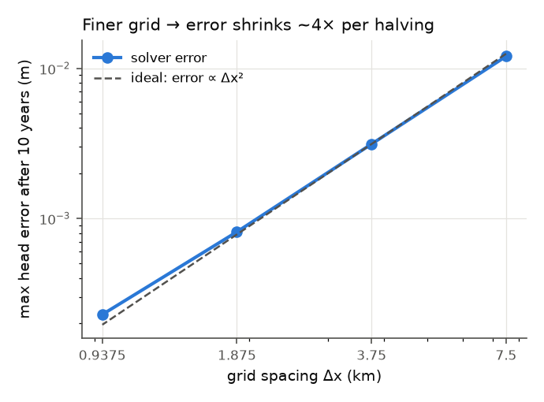
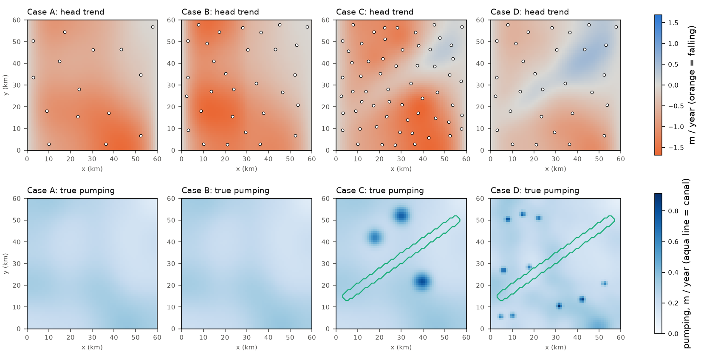
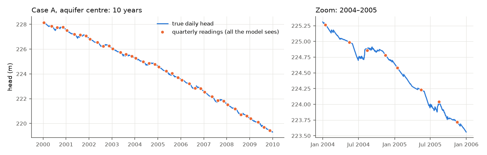

# M1 report: finite-difference solver and synthetic aquifers

*Generated by `scripts/check_m1.py`.*

## What M1 is

M1 builds a computer-simulated aquifer where we *know* the true storage (S), ease of flow (T), recharge (R) and pumping (Q).

- The simulator steps the groundwater equation S·∂h/∂t = T∇²h + R − Q forward one day at a time.
- It works on a grid of 1 km squares.

In M2 the PINN sees only sparse "well readings" from these simulations. It must recover the S, T and Q we put in.

## Done criteria (PLAN.md §5, M1)

| Check | Result | Status |
|---|---|---|
| Sine-mode decay (exact solution) matches | max error 8.1e-04 m on a 5 m bump (32×32 grid) | ✅ pass |
| Second-order convergence (~4× smaller error per halving of Δx) | observed orders 1.94, 1.94, 1.83 | ✅ pass |
| Closed box: h = h0 + (R−Q)·t/S | max error 4.7e-12 m | ✅ pass |
| Straight-line steady state stays put | max change 3.9e-12 m | ✅ pass |
| Water balance < 1e-8 every step | worst step 1.1e-10 (all tests and all 4 cases) | ✅ pass |
| Theis drawdown (optional, 1–3 km from the well) | within 0.4% | ✅ pass |

**What these checks mean in plain words:**
- **Exact solutions.** For a few simple situations, mathematicians have worked out the answer on paper.
  - The simulator reproduces those answers almost perfectly.
  - So its units, signs and boundaries are right.
- **Second-order convergence.** Making the grid twice as fine cuts the error about four times.
  - That is exactly what this method should do.
  - It shows there is no hidden bug that only appears at some resolutions.
- **Water balance.** Every day, the change in stored water equals recharge − pumping + inflow at the edges, to about one part in 10¹². No water is created or lost.

### Grid refinement (sine-mode decay, 10 years, Δt = 1 day)

| cells | dx_km | max_error_m | budget_max_rel | order |
|---|---|---|---|---|
| 8 | 7.50 | 1.20e-02 | 1.1e-10 |  |
| 16 | 3.75 | 3.13e-03 | 6.7e-11 | 1.94 |
| 32 | 1.88 | 8.13e-04 | 2.6e-11 | 1.94 |
| 64 | 0.94 | 2.29e-04 | 1.1e-11 | 1.83 |

The last order is a little below 2. At the finest grid, the 1-day time step's own small error starts to show, which is expected.

### Theis check (one well pumping 5,000 m³/day for a year)

| distance_km | simulated_m | theis_m | rel_diff |
|---|---|---|---|
| 0.5 | 1.002 | 0.989 | +1.4% |
| 1.0 | 0.634 | 0.632 | +0.4% |
| 2.0 | 0.305 | 0.305 | +0.1% |
| 3.0 | 0.151 | 0.151 | -0.0% |
| 5.0 | 0.032 | 0.032 | +0.3% |

Right next to the well (0.5 km) a 250 m grid cannot resolve the steep cone, so a few % difference is normal.

## The four synthetic aquifers (60 × 60 km, 10 years, 2000–2009)

| case | R true (m/yr) | R given to model (m/yr) | Q gross (m/yr) | Q net (m/yr) | head trend, whole area (m/yr) | head trend, central 20 km (m/yr) | seasonal swing at centre (m) | max budget error |
|---|---|---|---|---|---|---|---|---|
| A | 0.143 | 0.143 | 0.250 | 0.250 | -0.735 | -0.877 | 0.897 | 5.3e-13 |
| B | 0.143 | 0.143 | 0.250 | 0.250 | -0.809 | -0.867 | 0.764 | 2.7e-12 |
| C | 0.164 | 0.164 | 0.266 | 0.266 | -0.710 | -0.669 | 0.634 | 5.5e-13 |
| D | 0.213 | 0.143 | 0.247 | 0.198 | -0.221 | -0.004 | 0.449 | 5.4e-13 |

**What each case is for:**
- **A: homogeneous.** The main recovery test.
  - The centre falls about 0.9 m/yr, as planned.
  - The fixed-head edges (a river in the west, a regional level in the east) slow the fall near the sides.
- **B: two zones.** S and T differ west/east. It checks that zoning can find them (E17).
- **C: well-posed.** It adds a canal and three heavy-pumping clusters, which create 4–7 m cones.
  - Sideways flow toward the cones is what lets T be measured.
  - **This is the M2-A gate.**
- **D: mismatched (honest stress test).**
  - The real aquifer gets canal seepage and irrigation return flow that the model is *not* told about.
  - Pumping is patchy and has village hot spots.
  - The model's land-use map is blurred and noisy.
  - The extra hidden recharge (0.21 vs 0.14 m/yr given) cancels most of the decline, so the levels are nearly flat.
  - A model that trusts its wrong recharge will have to "explain" this with less pumping. That is exactly the bias M2 must measure and report.

*Top: 10-year head trend (orange = falling), with the training wells of each case's first design. Bottom: true pumping.*

This plot shows what the PINN is up against: the orange dots (4 readings a year) are all it sees of the blue curve.

## Files

- `data/synthetic/case_{A,B,C,D}/truth.nc`: daily heads plus the true S, T, recharge and pumping components (see `synthetic/generate.py`).
- `wells_*.parquet`: sampled wells (training wells plus 30 hidden wells for scoring).
  - Designs: A q30 and q15, B q30, C m60, D q30.
  - Noisy variants for the M2 run matrix are made on the fly with `synthetic.sample_wells.sample_wells`.

## Not done in M1 (on purpose)

**PyTorch (differentiable) solver.** PLAN.md lists one, but it is only needed for two things:
- the M2 fallback (a differentiable finite-difference inverse model), which needs your OK anyway;
- training-free forecasts, for which the numpy solver is enough.

It will be added if and when the fallback is needed.
