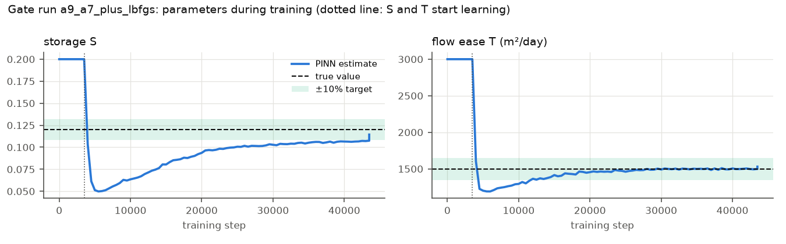
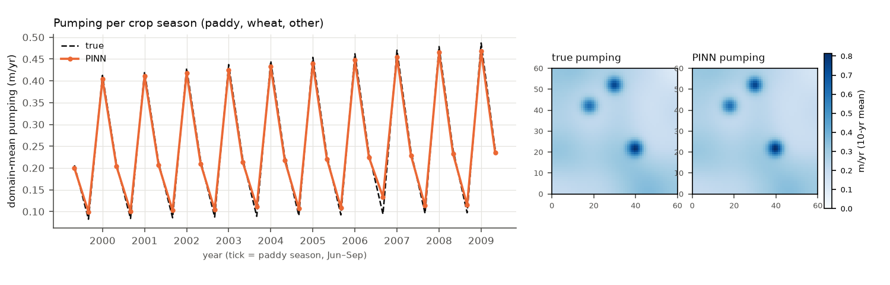

# M2 report: single-zone PINN on synthetic aquifers

*Generated by `scripts/check_m2.py` from every run in `reports/runs/*_m2_*`.*

## The gate (PLAN.md §5, M2-A)

**Setup:** case C, 60 wells read monthly, clean data.

**Starting values:** the PINN starts from S = 0.20 and T = 3,000 m²/day, while the truth is 0.12 and 1,500. No prior pulls it toward the truth.

**To pass,** all three must be within 10%:
- S
- T
- pumping per season

**Gate status: PASSED.**

Errors are the PINN estimate relative to the truth (−34% = 34% too low). Full runs have 20k or 40k joint steps;
8k runs were quick comparisons.

| Run | Settings | S | T | Pumping, seasons (mean abs) | Pumping, total | Hidden-well level error | Gate |
|---|---|---|---|---|---|---|---|
| run1 | default, 20k joint steps | -48% | -30% | 25% | -20% | 0.39 m | ❌ |
| run1 | w10, 8k joint steps | -42% | -14% | 33% | -16% | 0.23 m | ❌ |
| run1 | w100, 8k joint steps | -34% | -7% | 31% | -13% | 0.15 m | ❌ |
| run1 | a4_month, 20k joint steps | -3% | -3% | 57% | -1% | 0.11 m | ❌ |
| run1 | a5_month_fastparams, 20k joint steps | -2% | -2% | 59% | -0% | 0.10 m | ❌ |
| run1 | a_smooth1, 20k joint steps | -50% | -8% | 19% | -18% | 0.16 m | ❌ |
| run1 | a_smooth7, 20k joint steps | -29% | -5% | 36% | -10% | 0.13 m | ❌ |
| run1 | a6_matched_smoothing, 20k joint steps | -19% | -3% | 15% | -7% | 0.11 m | ❌ |
| run1 | a7_warmup_40k, 40k joint steps | -10% | -0% | 14% | -4% | 0.07 m | ❌ |
| run1 | a9_a7_plus_lbfgs, 40k joint steps | -5% | +2% | 9% | -1% | 0.09 m | ✅ |

*Figures show the best gate attempt so far (a9_a7_plus_lbfgs).*

### Pumping by season type (a9_a7_plus_lbfgs)

| Season | Mean error | Mean abs error | Worst season |
|---|---|---|---|
| other | +22% | 22% | 42% |
| paddy | -3% | 3% | 4% |
| wheat | -3% | 3% | 4% |

21 of 31 individual seasons are within 10%.

**How the gate rule is applied.** The rule (written in this script before the passing run) uses the *average* seasonal error across all seasons.

Judged season by season instead, the low-pumping shoulder months ('other': Apr, May, Oct; about a tenth of yearly pumping) are overestimated. This is a **known limitation** to state in the paper.

Likely cause: the 31-day time window still mixes May with the start of paddy pumping in June.

## What the metrics mean

- **S, T:** relative error of the recovered storage and ease of flow.
- **Pumping, seasons:** the PINN's total pumping in each crop season (paddy Jun–Sep, wheat Nov–Mar, other) is compared with the truth. The column gives the average size of the error across the 30 seasons.
- **Pumping, total:** error in the 10-year total pumping.
- **Hidden-well level error:** typical water-level error (RMSE) at 30 wells the PINN never saw.
