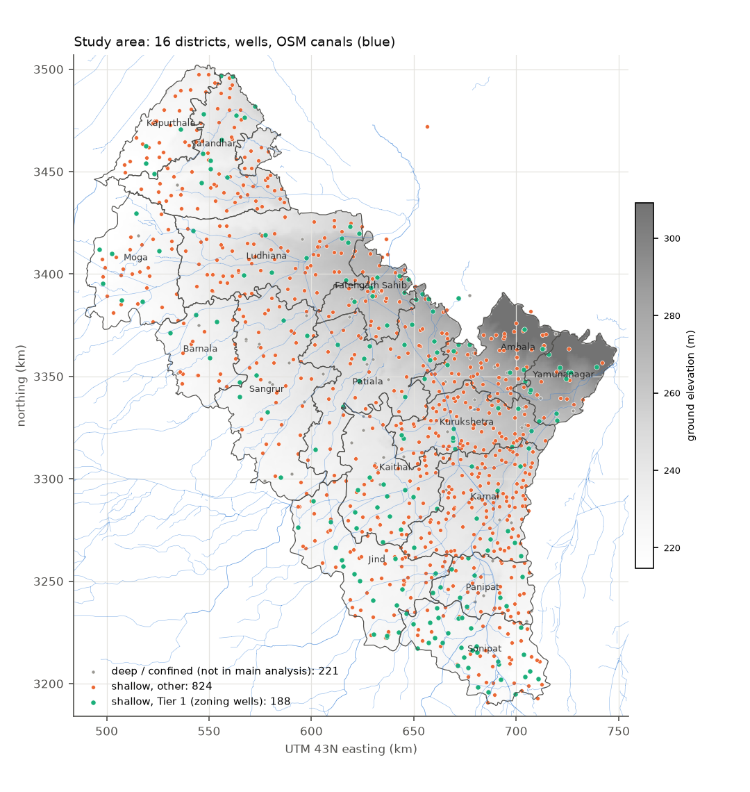
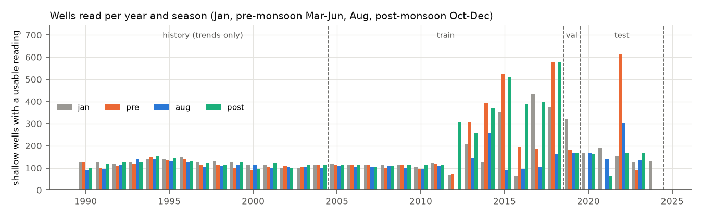
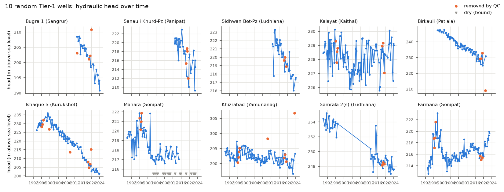

# M3 report: real-data master table and gaps

*Generated by `scripts/check_m3.py` from `data/processed/` (built by `scripts/build_master.py`).*

## What was built

| File | What | Size |
|---|---|---|
| `master.parquet` | one row per well × reading, QC flags, head, rainfall windows | 28,296 readings, 1,233 wells |
| `wells.parquet` | one row per well: location, type, depth, depth class, land use, canals, Tier 1 | 1,233 wells |
| `static_1km.nc` | 1 km UTM grid (271 × 323 cells): districts, elevation, land cover, canals | 35,636 cells in the study area |
| `rain_daily.nc` | IMD daily rain, native 0.25° grid, 1990-2024 | |
| `telemetry_daily.parquet` | cleaned daily telemetry (DWLR) depth to water | 210 wells, 193,009 well-days |

**Schema check:** all checks pass.

## Wells in the analysis

- **Shallow wells** (unconfined aquifer): 1012. These are the main analysis.
- **Deep wells** (confined / semi-confined, nested medium or deep piezometers, or ≥ 150 m deep): 221. These are excluded from the main analysis because they tap a different aquifer layer.
- **Tier 1** (shallow, ≥ 5 training years with both a pre- and post-monsoon head): **188 wells**. These are the zoning wells (M4).
- **Shallow wells with ≥1 usable head:** train 843, validation 390, test 770.

**Correction to G0.** G0 counted 193 Tier-1 wells as "unconfined or unknown aquifer". But many nested
piezometers named "... M" or "... D" (medium/deep, median depth about 200-300 m) have a *blank* aquifer field, so G0 wrongly
included some of them. With the depth class above, Tier 1 is 188. This is still enough for k = 1, 3 and 5 zones.

### By district (shallow wells; readings = usable heads)

| district | wells | shallow | tier1 | outside_gadm | history_readings | train_readings | val_readings | test_readings |
|---|---|---|---|---|---|---|---|---|
| Ambala | 78 | 60 | 9 | 3 | 615 | 527 | 25 | 173 |
| Barnala | 27 | 23 | 5 | 0 | 177 | 294 | 18 | 57 |
| Fatehgarh Sahib | 51 | 45 | 10 | 2 | 166 | 644 | 50 | 159 |
| Jalandhar | 103 | 77 | 11 | 4 | 750 | 864 | 69 | 209 |
| Jind | 86 | 79 | 19 | 0 | 1,090 | 919 | 62 | 232 |
| Kaithal | 71 | 55 | 14 | 0 | 687 | 655 | 52 | 198 |
| Kapurthala | 55 | 42 | 5 | 0 | 143 | 527 | 25 | 119 |
| Karnal | 152 | 133 | 11 | 0 | 0 | 535 | 66 | 141 |
| Kurukshetra | 111 | 94 | 9 | 0 | 153 | 500 | 30 | 159 |
| Ludhiana | 107 | 89 | 11 | 0 | 339 | 1,056 | 99 | 258 |
| Moga | 43 | 37 | 7 | 0 | 148 | 439 | 34 | 96 |
| Panipat | 57 | 42 | 9 | 1 | 355 | 481 | 43 | 145 |
| Patiala | 87 | 67 | 17 | 4 | 404 | 977 | 74 | 253 |
| Sangrur | 70 | 50 | 6 | 2 | 134 | 478 | 44 | 114 |
| Sonipat | 81 | 79 | 31 | 3 | 1,299 | 1,371 | 93 | 312 |
| Yamunanagar | 54 | 40 | 14 | 0 | 619 | 562 | 59 | 194 |
| Total | 1,233 | 1,012 | 188 | 19 | 7,079 | 10,829 | 843 | 2,819 |

## Quality control

| Flag | Readings | Meaning | Used? |
|---|---|---|---|
| ok | 26,571 | passes all checks | yes |
| suspect_jump | 15 | a lasting step of > 15 m from the previous reading | yes, flagged |
| spike | 350 | one or two readings > 5 m away from both neighbours, which agree | no |
| outlier | 29 | > 20 m (+1 m per year of gap) from the well's nearest-in-time readings | no |
| below_bottom | 45 | deeper than the well itself | no |
| out_of_range | 9 | depth to water > 100 m | no |
| nonpositive | 7 | water at or above ground | no |
| duplicate | 1,270 | same well and day, or the same value repeated within 31 days (a copied entry) | no |

**Dry readings** (within 1 m of the well bottom): 330. These are treated as *censored*: the true level is at
or below the bottom, so only that bound is kept (no head value). By well type:

| Well type | Dry readings | Share |
|---|---|---|
| Bore Well | 0 | 0.0% |
| Dug Well | 316 | 2.8% |
| Piezometer | 0 | 0.0% |
| Tube Well | 14 | 0.1% |
| unknown | 0 | 0.0% |

**Sanity check (PLAN.md M3: no 20 m jumps):** among shallow wells, 13 of 20,567 consecutive
head changes exceed 20 m (81 exceed 10 m). 9 of the 20 m changes span a gap of
more than 3 years between readings, which fits real long-term decline (about 1 m a year here). The rest are a handful
of messy wells, kept but flagged where the step is within a year. Spot-check plot of 10 random Tier-1 wells:

## Inputs at each well and on the grid

| Input | Source | How |
|---|---|---|
| Ground elevation | Copernicus GLO-30 DEM | averaged to ~1 km (smooths village buildings and DEM noise), bilinear at wells |
| Head | elevation − depth to water | 1 km elevation vs the raw 30 m value at wells: median difference +0.3 m, 90% within ±3.9 m |
| Rainfall | IMD 0.25° daily | bilinear at wells; rain since the previous reading; last monsoon (Jun-Sep) total |
| Recharge (first estimate) | rain × 0.22 | GEC-2015 norm for Indo-Gangetic alluvium (report Table 4: 22%, range 20-25%) |
| Land use | ESA WorldCover 2021 | fraction of cropland / built-up / trees per 1 km cell; cropland covers 85.3% of the area |
| Canals | OpenStreetMap | distance to nearest canal (median 3.3 km at wells) and canal length per km² |

## Starting values for S and T (from CGWB district reports)

Full table with page numbers: `configs/priors.yaml`. Belt-wide starting value: S = 0.12, T = 1,500 m²/day.

| District | T, shallow aquifer (m²/day) | Note |
|---|---|---|
| Ambala | 154-4,900 | test wells 150-400 m deep; storativity 1.4e-4 to 0.10 |
| Jind | 1,176 |  |
| Kaithal | 400-1,400 | central 686 m2/day, Sy 0.0235; north 400, Sy 0.12 |
| Karnal | 2,200 | Upper Yamuna Project average for the upper group |
| Kurukshetra | 830-2,424 | unconfined group average 2200 |
| Panipat | 127-1,580 | Bapoli-Samalkha 2024 study, several methods, one site |
| Sonipat | not available | NCR Vol II report is scanned; no text extracted - use belt prior |
| Yamunanagar | 875-2,500 |  |
| Barnala | 1,620-2,000 | storativity 0.014-0.075 |
| Fatehgarh Sahib | 1,555-4,222 | Aquifer-I summary 1780 (p53) |
| Jalandhar | 1,028-5,750 |  |
| Kapurthala | not available | only a deep (278-394 m) test: 987 |
| Ludhiana | 628-1,120 |  |
| Moga | 5,750 | same numbers as Jalandhar - likely copied |
| Patiala | 900-9,410 |  |
| Sangrur | 1,620-2,000 | text identical to Barnala - likely copied |

**Caveat:** specific yield is almost never measured. The reports use the GEC norm of 12% (or 60% of it, 0.072).
So the S starting value is a convention, and the PINN's S estimate on real data can't be checked against an
independent measurement. T comes from a few pumping tests per district and varies by more than 10× within a district.

## Known gaps and limitations

1. **Karnal before 2019.** WRIS has Karnal only for 2019-2022. The India Data Portal file fills 2013-2021 (836 readings). 10 of its wells were matched to WRIS wells by location and depth suffix, and 16 duplicate readings were dropped. Unmatched IDP wells have no type, depth or aquifer metadata.
2. **Missing metadata.** Well type is missing for 15.3% of wells, depth for 15.4%, aquifer type for 35.4%. Wells without depth can't be checked for dry readings.
3. **Network change in 2012** (from G0). Dug wells dominate 2005-2011, tube wells 2012 onwards. Zones (M4) must be checked against well type.
4. **Land use is static.** WorldCover is a single year (2021), so changes in cropping over 2005-2024 aren't captured. Bhuvan LULC 50K (2005-06, 2011-12, 2015-16) is on disk only as rendered map tiles; decoding it into crop-season fractions is a possible later improvement.
5. **Canals are incomplete.** OSM maps main canals and branches well but misses many small distributaries, so canal density is a lower bound. Canal seepage is not in the recharge estimate yet.
6. **Elevation is a surface model.** Copernicus is a DSM (includes buildings and trees). The 1 km averaging reduces this, but heads can carry a few metres of constant error per well. This affects head gradients (and so T), not water-level changes over time.
7. **Wells outside the GADM district outlines:** 19. These are near borders (WRIS and GADM boundaries differ); they are kept and flagged.
8. **Telemetry** is noisy: 895,338 raw 6-hourly values were cleaned to 193,009 well-days (210 wells, median 952 days each). Used only as a bonus within-season test.
9. **Few readings per year.** Most wells are read 4 times a year (Jan, pre-monsoon, Aug, post-monsoon). M2 showed this sampling is where the PINN currently struggles.

## What the terms mean

- **Depth to water:** what CGWB measures, metres from the ground down to the water.
- **Head:** the height of the water table above sea level (elevation − depth to water). The flow equation works with head.
- **Censored reading:** we only know the water is *at least* this deep (the well was dry), not the exact level.
- **Tier 1:** wells with long enough records to describe their seasonal and long-term behaviour, used to form zones.
