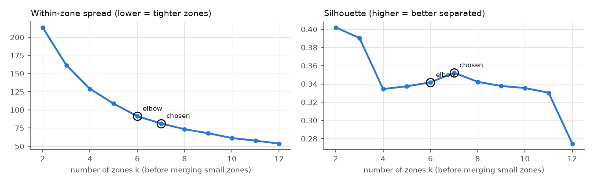
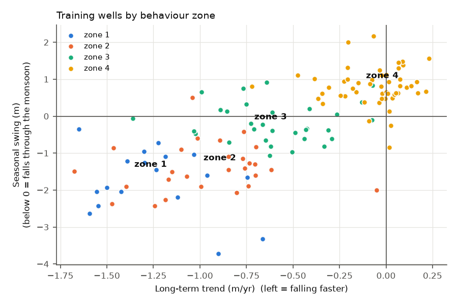
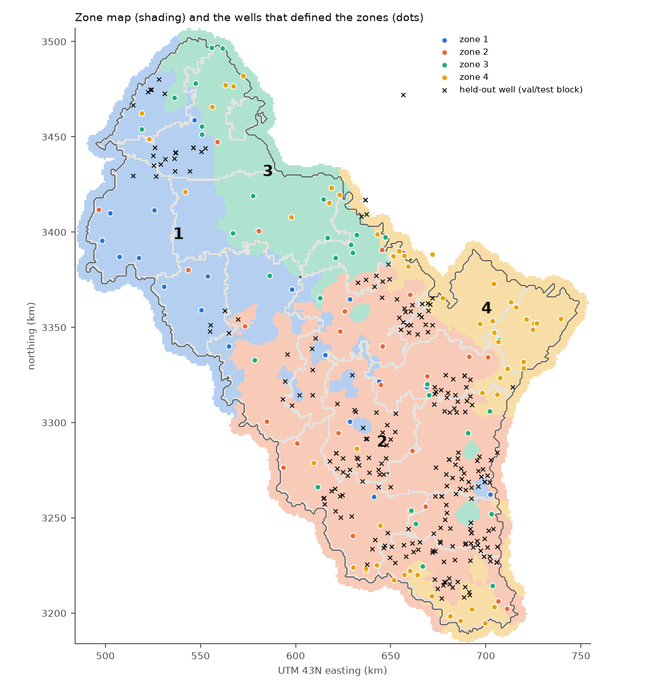

# M4 report: zoning

*Generated by `scripts/check_m4.py` from the outputs of `scripts/build_zones.py`.*

## Summary

- **Zones:** 4 zones on the main layout (k = 7 asked, small zones merged). Smallest zone: 18 wells. Every zone meets the minimum of 12.
- **Zone map:** saved as `data/processed/zone_map.tif` and `zones.gpkg`. Zones for every layout and every k of the sweep are in `zones.nc`.
- **Assignment accuracy:** 40%, against 41% for always guessing the biggest zone. **The map rule is barely better than guessing.**
- **Why:** well behaviour is only partly a regional pattern. The long-term trend is the most mappable feature, but even it is only about one-third predictable in an unseen 20 km block. The monsoon response is not predictable at all (see *Is behaviour a map?* below).
- **What this means:** zones describe real differences between the wells that have history, but a held-out well or an unmonitored place often lands in the wrong zone. This is weakness 2 in the brief (§6.4), now measured. The early zoning preview (after the M5 baselines) will show whether zoning still helps prediction.

## 1. Spatial block splits

The area is cut into 20 km blocks. Whole blocks are held out: about 18% of wells for testing and 10% for validation (tuning only).

Shares are counted over the 1003 shallow wells with at least one usable water level. Layout 0 is the main layout, fixed in advance. Layouts 1 and 2 are the repeats for experiment E16.

| Layout | train wells | val wells | test wells | train Tier 1 | val Tier 1 | test Tier 1 | Wells clustered | Chosen k |
|---|---|---|---|---|---|---|---|---|
| 0 | 762 | 82 | 159 | 129 | 22 | 37 | 129 | 7 |
| 1 | 763 | 80 | 160 | 138 | 24 | 26 | 138 | 5 |
| 2 | 765 | 83 | 155 | 142 | 14 | 32 | 142 | 5 |

*Tier 1* = wells with at least 5 training years that have both a pre- and a post-monsoon reading. Only these get behaviour features.

## 2. Behaviour features (training years 2005–2018 only)

| Feature | What it measures |
|---|---|
| Seasonal swing | mean rise from the pre-monsoon (Mar–Jun) to the post-monsoon (Oct–Dec) reading. Below 0 means the level falls through the monsoon, usually because paddy pumping outweighs recharge |
| Long-term trend | Theil–Sen slope of the pre-monsoon level (m per year). Theil–Sen takes the median of all pairwise slopes, so a few bad readings cannot swing it |
| Monsoon response | how much more the level rises in a wetter monsoon, per 100 mm of extra June–September rain |

188 wells have features. The median well falls 0.40 m a year, and the fastest falls 1.7 m a year.

Before clustering, each feature is clipped to its 2nd–98th percentile and standardised, so all three count equally.

## 3. Choosing the number of zones

k-means is run for k = 2 to 12 on the training wells of each layout. The rule was fixed before looking at the zones: take the *elbow* (the k after which more zones stop tightening the groups much), then the best *silhouette* among the elbow and its two neighbours.

Zones smaller than 12 wells are then merged into the zone with the nearest centre. Zones are numbered from the steepest decline (zone 1) to the slowest.

Main layout: elbow k = 6, chosen k = 7, giving 4 zones after merging.

## 4. The zones

| Zone | Wells that defined it | Training wells in map zone | Val wells | Test wells | Area (km²) | Patches | Trend (m/yr) | Seasonal swing (m) | Monsoon response (m/100 mm) |
|---|---|---|---|---|---|---|---|---|---|
| 1 | 18 | 129 | 6 | 28 | 11022 | 8 | -1.26 | -1.63 | +0.03 |
| 2 | 27 | 257 | 74 | 114 | 17119 | 2 | -0.89 | -1.45 | +0.51 |
| 3 | 31 | 136 | 0 | 2 | 6985 | 4 | -0.62 | -0.34 | +0.07 |
| 4 | 53 | 119 | 2 | 15 | 6233 | 4 | -0.02 | +0.77 | +0.24 |

*Training wells in map zone* = every shallow well in a training block that has training-period readings and falls inside the zone on the map. These are the wells the zone's PINN will learn from.

## 5. How the map is made, and how often it assigns the right zone

1. A random forest learns each training well's zone from features known everywhere: easting, northing, elevation, cropland, built-up and tree cover, distance to the nearest canal, and canal density. Values are read from the well's 1 km cell.
2. It labels every 1 km cell of the 16 districts plus a 5 km buffer.
3. A 7 × 7 km majority filter removes speckle, and patches under 50 km² join the zone around them.
4. Every well, including held-out ones, takes the zone of its map cell.

**Assignment accuracy** is measured the way the map will be used. The training wells are split into 5 groups of whole 20 km blocks. For each group, the map is rebuilt without it, and we check whether its wells land in their own behaviour zone.

*Guessing the biggest zone* is the score of calling every well the most common zone, so only accuracy above it means the map has learned something.

| Layout | k asked | Zones after merging | Smallest zone (wells) | Map accuracy, unseen blocks | Guessing the biggest zone | Patches (total) |
|---|---|---|---|---|---|---|
| 0 | 3 | 3 | 18 | 55% | 47% | 26 |
| 0 | 5 | 4 | 20 | 36% | 43% | 17 |
| 0 | 7 (chosen) | 4 | 18 | 40% | 41% | 18 |
| 0 | 8 | 5 | 12 | 39% | 40% | 25 |
| 1 | 3 | 3 | 27 | 54% | 49% | 10 |
| 1 | 5 (chosen) | 5 | 17 | 36% | 34% | 31 |
| 1 | 8 | 6 | 17 | 36% | 31% | 33 |
| 2 | 3 | 3 | 28 | 49% | 51% | 6 |
| 2 | 5 (chosen) | 5 | 12 | 39% | 35% | 33 |
| 2 | 8 | 5 | 18 | 36% | 30% | 23 |

## 6. Is behaviour a map? (why accuracy is low)

For each feature, the table shows two things:
- *Alike* columns: how similar wells are at different distances apart (a correlation: 1 = identical, 0 = unrelated).
- *Predicted* columns: how well the value of a well in an unseen block is predicted (R²: 1 = perfectly, 0 = no better than the average of all wells).

| Feature | Nearest well alike | Alike at 0-10 km | Alike at 10-20 km | Alike at 20-40 km | Alike at 40-80 km | Predicted in unseen block (static features) | Predicted in unseen block (5 nearest wells) |
|---|---|---|---|---|---|---|---|
| Seasonal swing (m) | +0.56 | +0.46 | +0.29 | +0.19 | -0.03 | +0.25 | +0.16 |
| Long-term trend (m/yr) | +0.68 | +0.60 | +0.45 | +0.21 | -0.01 | +0.35 | +0.34 |
| Monsoon response (m per 100 mm) | +0.12 | +0.11 | +0.02 | +0.04 | +0.05 | -0.02 | -0.27 |

**Reading:**
- **Trend and seasonal swing are regional patterns.** Neighbouring wells are fairly alike, and the likeness fades to nothing by about 40 km. But with wells about 6 km apart and blocks of 20 km, only about a third of the trend can be predicted in an unseen block.
- **The monsoon response is noise at the well level.** It is a slope through only 5–14 points per well, so it differs randomly between neighbours.
- **Both ways of predicting score the same,** whether from static features or from the 5 nearest wells. So a better classifier would not help much. The limit is how patchy the behaviour is relative to the well spacing.

## 7. Done criteria (PLAN.md §5 M4)

| Criterion | Status |
|---|---|
| Every zone has at least 10–15 training wells | ✅ smallest zone: 18 wells |
| Zone map saved | ✅ `zone_map.tif`, `zones.gpkg`, `zones.nc` |
| Assignment accuracy reported | ✅ 40% (guessing: 41%) — **below the 60% warning level in the risk register** |
| Early zoning preview | ⏳ needs the M5 baselines (zoned vs unzoned random forest and bucket model on validation blocks) |

## Plain-language glossary

- **k-means:** sorts wells into k groups so that wells in a group have similar features.
- **Spatial block hold-out:** hiding whole areas, not single wells, so the test measures prediction in places the model has never seen.
- **Correlation:** from −1 to 1; how strongly two sets of numbers move together.
- **R²:** the share of the differences between wells that a prediction explains (1 = all, 0 = none).
- **Random forest:** many decision trees voting; a standard, robust classifier.
