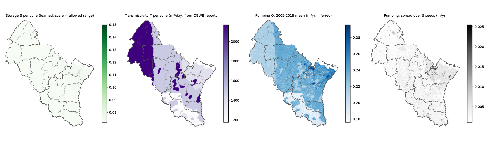
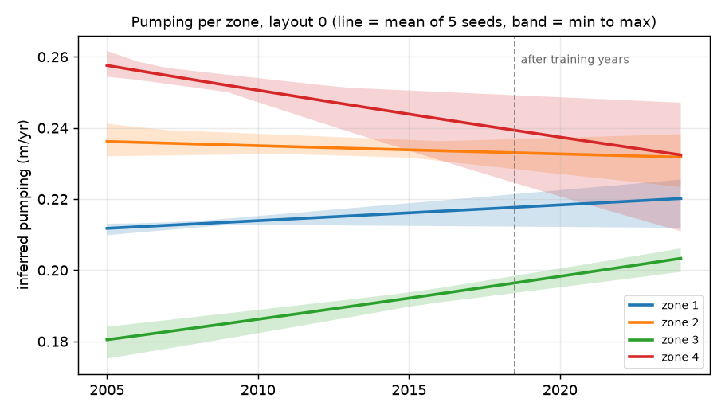
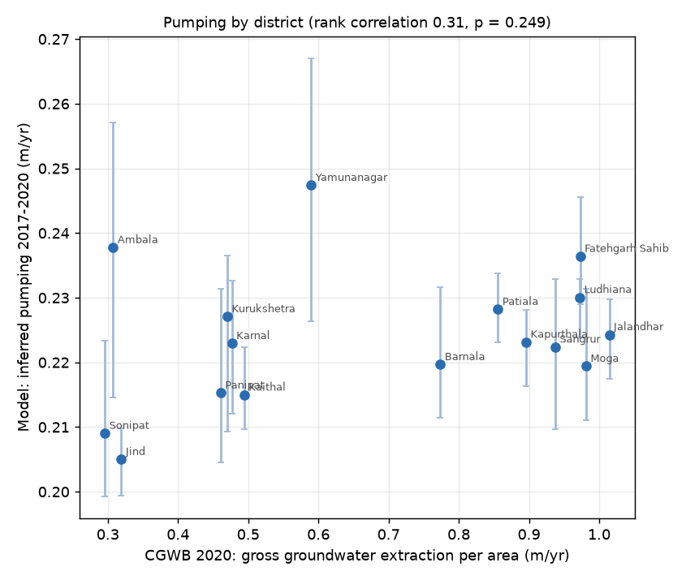

# M7 report: uncertainty, plausibility, storage/transmissivity/pumping maps, pumping vs CGWB

*Generated by `scripts/check_m7.py`.* Final models: shared zoned PINN and regional PINN, both with canal seepage (tag `tbc`), 5 seeds × 3 block layouts. Nothing was trained or tuned for this report.

## 1. Uncertainty: are the stated ranges honest?

Each model is 5 copies trained from different random starts. Where they disagree, the model is less sure. A *90% range* should contain the real value 9 times out of 10; that share is the *coverage*.

Three versions of the range: (a) seed spread only; (b) seed spread plus a noise term (the training-fit error, about 1.2 m); (c) version (b) widened by one factor per task, **fitted on the validation set (2019 and validation blocks) and applied unchanged to the test set**.

| model | task | val coverage, seeds only | test coverage, seeds only | test coverage, seeds + noise | factor c (from val) | test coverage, calibrated | calibrated half-width (m, median) | test readings |
|---|---|---|---|---|---|---|---|---|
| regional | A | 22% | 22% | 46% | 1.5 | 63% | ± 3.4 m | 6340 |
| regional | B | 12% | 11% | 19% | 4.9 | 80% | ± 11.9 m | 5680 |
| regional | C | 12% | 13% | 20% | 4.4 | 70% | ± 11.3 m | 1444 |
| zoned | A | 22% | 23% | 45% | 1.5 | 64% | ± 3.5 m | 6340 |
| zoned | B | 12% | 13% | 21% | 4.8 | 84% | ± 11.8 m | 5680 |
| zoned | C | 11% | 12% | 20% | 4.2 | 69% | ± 10.7 m | 1444 |

**In plain words:** the seed spread alone is far too narrow: on test it catches the real value only 13% of the time at places without wells (should be 90%). After calibrating on validation, test coverage is 64% (A), 84% (B) and 69% (C). So the target (90% within about 5 points) is **nearly met at places without wells in the training years (B)** and **not met for later years (A, C)**: the factor was fitted on 2019, one year after training, and errors keep growing after that (table below). Honest ranges are also wide: about 12 m either side at places without wells.

Coverage of the calibrated zoned ranges by test year (A and C get harder further from the training years; the factor was fitted on 2019 only):

| year | A | C |
|---|---|---|
| 2020 | 71% | 69% |
| 2021 | 70% | 66% |
| 2022 | 65% | 71% |
| 2023 | 54% | 67% |
| 2024 | 52% | 70% |

## 2. Physical plausibility: does the water rise when it shouldn't?

Setting: heavily farmed cells (cropland ≥ 80%, 28,145 cells) in the dry season from 15 January to 15 May (wheat irrigation, then pre-monsoon pumping), in years when that season's rain was below the cell's 2005-2024 median. Here the water table is expected to fall. Measured wells (January and May readings in the same year) show how often it really rose.

| model | years | map: dry cell-years with a rise | map: rise > 0.5 m | wells: model rise | wells: measured rise | well-years |
|---|---|---|---|---|---|---|
| zoned | 2005-2018 | 3% | 0% | 3% | 23% | 320 |
| zoned | 2019-2024 | 4% | 0% | 7% | 24% | 59 |
| zoned | all | 3% | 0% | 4% | 23% | 379 |
| regional | 2005-2018 | 3% | 0% | 4% | 23% | 320 |
| regional | 2019-2024 | 3% | 0% | 3% | 24% | 59 |
| regional | all | 3% | 0% | 4% | 23% | 379 |

**In plain words:** across all years the zoned model has the water rising in 3% of dry, heavily farmed cell-seasons (regional: 3%). Measured wells in the same setting rose in 23% of cases (some rises are real: canal water, delayed monsoon recharge, measurement noise). So the model is **physically plausible**: it almost never has the water rising in a dry, heavily pumped season. It rises far *less* often than real wells do, which means it is smoother than reality: it captures the steady decline but misses short local rises.

## 3. Storage, transmissivity and pumping maps (layout 0)

- **S (storage, specific yield):** learned per zone, but held inside 0.072-0.15 (the CGWB NAQUIM range for this alluvium). 83% of zone values sit at the lower limit 0.072: the data push S lower than the reports allow. S is therefore set by the allowed range more than by the data. This is a limitation to state.
- **T (transmissivity):** not learned; fixed per zone from the CGWB reports. On the synthetic tests, learning T together with S let both drift (M2 run3: T −79%), while fixing T kept S, and total pumping, within 10%.
- **Q (pumping):** inferred, **not measured**. Area mean 0.22 m/yr over 2005-2018; typical spread between seeds 0.003 m/yr. The pattern follows cropland and zones by construction (the pumping network only sees land use, month, zone and a slow trend).

| layout | zone | S (mean, min-max over seeds) | T (m²/day) |
|---|---|---|---|
| 0 | 1 | 0.072 (0.072-0.072) | 2172 |
| 0 | 2 | 0.072 (0.072-0.072) | 1487 |
| 0 | 3 | 0.072 (0.072-0.072) | 1175 |
| 0 | 4 | 0.074 (0.072-0.077) | 1379 |
| 1 | 1 | 0.072 (0.072-0.072) | 1958 |
| 1 | 2 | 0.072 (0.072-0.072) | 1340 |
| 1 | 3 | 0.072 (0.072-0.072) | 1789 |
| 1 | 4 | 0.072 (0.072-0.072) | 1279 |
| 1 | 5 | 0.078 (0.072-0.086) | 1320 |
| 2 | 1 | 0.072 (0.072-0.073) | 2167 |
| 2 | 2 | 0.072 (0.072-0.072) | 1408 |
| 2 | 3 | 0.072 (0.072-0.072) | 1588 |
| 2 | 4 | 0.072 (0.072-0.072) | 1081 |
| 2 | 5 | 0.079 (0.073-0.090) | 1359 |

## 4. Pumping compared with CGWB district figures

CGWB's 2020 assessment estimates gross groundwater extraction per district (GEC-2015 method). Converted to metres of water per year over the district area, it is compared with the model's inferred pumping (2017-2020 mean, all 15 zoned runs). Both are estimates, so agreement supports the model and disagreement is not proof of error.

| District | State | CGWB 2020 extraction (m/yr) | Model pumping 2017-20 (m/yr) | Model range over 15 runs |
|---|---|---|---|---|
| Jalandhar | Punjab | 1.01 | 0.22 | 0.22-0.23 |
| Moga | Punjab | 0.98 | 0.22 | 0.21-0.23 |
| Fatehgarh Sahib | Punjab | 0.97 | 0.24 | 0.23-0.25 |
| Ludhiana | Punjab | 0.97 | 0.23 | 0.22-0.23 |
| Sangrur | Punjab | 0.94 | 0.22 | 0.21-0.23 |
| Kapurthala | Punjab | 0.90 | 0.22 | 0.22-0.23 |
| Patiala | Punjab | 0.86 | 0.23 | 0.22-0.23 |
| Barnala | Punjab | 0.77 | 0.22 | 0.21-0.23 |
| Yamunanagar | Haryana | 0.59 | 0.25 | 0.23-0.27 |
| Kaithal | Haryana | 0.49 | 0.21 | 0.21-0.22 |
| Karnal | Haryana | 0.48 | 0.22 | 0.21-0.23 |
| Kurukshetra | Haryana | 0.47 | 0.23 | 0.21-0.24 |
| Panipat | Haryana | 0.46 | 0.22 | 0.20-0.23 |
| Jind | Haryana | 0.32 | 0.20 | 0.20-0.21 |
| Ambala | Haryana | 0.31 | 0.24 | 0.21-0.26 |
| Sonipat | Haryana | 0.30 | 0.21 | 0.20-0.22 |

- **Pattern:** rank correlation across the 16 districts = 0.31 (p = 0.25; 1 = same order of districts, 0 = unrelated; p above 0.05 = could easily be chance). CGWB has the Punjab districts extracting 2.2× as much per hectare as the Haryana ones; the model has them almost equal (1.01×), at 0.20-0.25 m/yr everywhere. **The model does not recover the district pattern of pumping.** Its pumping network sees only cropland share (high almost everywhere), month, zone and a slow trend, so it cannot tell districts apart. Differences in decline between places end up in the water-level network instead.
- **Size:** the model's pumping is 0.33× CGWB's gross extraction on average. This is expected to be below 1: the model's Q is *net* pumping (water that leaves the aquifer for good). Part of what is pumped soaks back from irrigated fields, and CGWB counts that return flow as recharge instead. With S at its lower limit, the model also needs less pumping to explain the observed decline.

## What M7 adds to the results

- **Uncertainty:** the raw seed spread is badly over-confident (12-23% coverage for a 90% range), as the literature warns. Calibrating on validation fixes it for places without wells in the training years (84%), but not for later years (64-69%).
- **Plausibility: passed.** The model almost never has water rising in dry, heavily pumped seasons (3%, wells: 23%).
- **Physical parameters: not recovered.** S sits at its lower limit and T is fixed from reports, so neither is learned from these data.
- **Pumping: total size plausible, pattern not.** Net pumping of about 0.22 m/yr is a third of CGWB's gross extraction (expected to be lower), but it is almost uniform and does not reproduce CGWB's Punjab-Haryana difference. Pumping maps must not be presented as findings about where pumping is highest.
