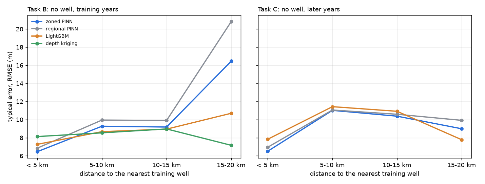

# M8: error against distance to the nearest training well

*Generated by `scripts/check_distance.py`.* Places without a well (held-out blocks): Task B (2005-2018) and Task C (2019-2024), validation and test readings, the 3 block layouts pooled. Every model is scored on the same readings. PINNs are the v1.0 5-seed ensembles. Descriptive only: nothing was chosen from this.

| task | distance | readings | wells | zoned PINN | regional PINN | LightGBM | depth kriging | zoned vs regional |
|---|---|---|---|---|---|---|---|---|
| B | < 5 km | 1449 | 108 | 6.46 | 6.85 | 7.27 | 8.13 | -6% |
| B | 5-10 km | 4699 | 298 | 9.27 | 9.95 | 8.67 | 8.54 | -7% |
| B | 10-15 km | 1865 | 125 | 9.18 | 9.91 | 8.95 | 8.97 | -7% |
| B | 15-20 km | 166 | 12 | 16.46 | 20.83 | 10.7 | 7.16 | -21% |
| C | < 5 km | 341 | 89 | 6.51 | 6.95 | 7.83 |  | -6% |
| C | 5-10 km | 920 | 236 | 11.02 | 11.06 | 11.43 |  | -0% |
| C | 10-15 km | 363 | 97 | 10.38 | 10.59 | 10.92 |  | -2% |
| C | 15-20 km | 24 | 7 | 8.99 | 9.92 | 7.78 |  | -9% |

Depth kriging was only run for Task B. Bands with fewer than 20 wells (15-20 km) are shaky.

Rank correlation between distance and the zoned PINN's error per reading: B 0.18, C 0.19 (0 = unrelated, 1 = error always grows with distance).
