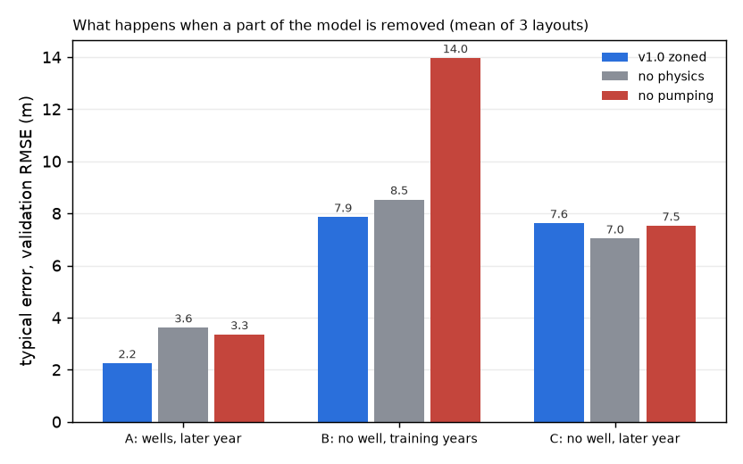
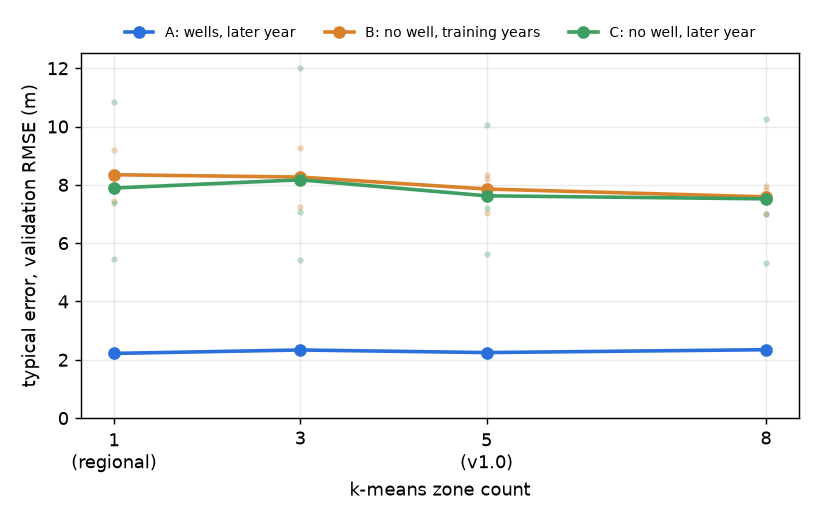

# M8: ablations and zone count (validation only)

*Generated by `scripts/check_m8.py`. Rules and run list in `reports/batch5_rules.md`, written before the runs. Nothing was chosen from these results.*

Validation = 2019. Typical error = RMSE in metres. Three tasks:
- **A**: wells the model trained on, forecast one year ahead.
- **B**: places with no well (held-out 20 km blocks), training years 2005-2018.
- **C**: places with no well, the later year.

Score = A / 1.90 + B / 7.94 (lower is better), the same score used for every earlier decision. v1.0 and the regional PINN average 5 seeds; each other row is one seed (seed 0) per layout. One seed alone moves the score by about 1.5%, so differences under about 2% are noise.

## 1. Removing parts of the model

| model | what | runs | zones (after merging) | val A (m) | val B (m) | val C (m) | score | vs v1.0 | layouts worse than v1.0 |
|---|---|---|---|---|---|---|---|---|---|
| v1.0 zoned | v1.0: physics + pumping, k-means k = 5 | 15 | 4/5/5 | 2.25 | 7.86 | 7.62 | 2.172 | +0.0% |  |
| no physics | flow equation switched off (data only) | 3 | 4/5/5 | 3.62 | 8.53 | 7.03 | 2.977 | +37.1% | 3 of 3 |
| no pumping | pumping switched off (Q = 0) | 3 | 4/5/5 | 3.35 | 13.96 | 7.52 | 3.521 | +62.1% | 3 of 3 |

## 2. Number of zones

k is the k-means zone count before small zones are merged into neighbours (each zone needs at least 10 wells), so the zones actually used differ per layout (column 'zones').

| model | what | runs | zones (after merging) | val A (m) | val B (m) | val C (m) | score | vs v1.0 | layouts worse than v1.0 |
|---|---|---|---|---|---|---|---|---|---|
| k = 1 (regional) | one zone: the regional PINN | 15 | 1/1/1 | 2.22 | 8.35 | 7.89 | 2.219 | +2.1% | 2 of 3 |
| k = 3 | k-means k = 3 | 3 | 3/3/3 | 2.34 | 8.27 | 8.17 | 2.27 | +4.5% | 3 of 3 |
| v1.0 zoned | v1.0: physics + pumping, k-means k = 5 | 15 | 4/5/5 | 2.25 | 7.86 | 7.62 | 2.172 | +0.0% |  |
| k = 8 | k-means k = 8 | 3 | 6/7/5 | 2.35 | 7.59 | 7.52 | 2.19 | +0.8% | 3 of 3 |

Line = mean of the 3 layouts; faint dots = each layout. The spread between layouts (dots) is much larger than the differences between zone counts.

## 3. Well by well (seed 0 against v1.0 seed 0, 3 layouts pooled)

Share of wells where the variant's error is lower than v1.0's. 50% = no difference. p = Wilcoxon signed-rank test on the paired per-well errors (below 0.05 = unlikely to be chance).

| model | A: wells better than v1.0 | B: wells better than v1.0 | C: wells better than v1.0 |
|---|---|---|---|
| no physics | 34% of 890 (p 0.000) | 51% of 196 (p 0.601) | 58% of 91 (p 0.460) |
| no pumping | 39% of 890 (p 0.000) | 38% of 196 (p 0.001) | 46% of 91 (p 0.567) |
| k = 3 | 51% of 890 (p 0.547) | 41% of 196 (p 0.000) | 37% of 91 (p 0.001) |
| k = 8 | 48% of 890 (p 0.780) | 53% of 196 (p 0.240) | 60% of 91 (p 0.114) |

Reference: v1.0 val A 2.25, B 7.86, C 7.62, score 2.172.

## What it means (written after reading the numbers above)

1. **Physics helps forecasting through time.** Without the flow equation, the one-year-ahead forecast at monitored wells is much worse (A 3.6 m vs 2.2 m; worse at two thirds of wells). At places without a well there is no clear difference either way (B and C: about half the wells better, not significant). So the physics earns its place in the forecast, not in filling the map between wells.
2. **Inferred pumping is needed.** Without pumping, the error at places without a well almost doubles (B 14.0 m vs 7.9 m, worse at 62% of wells, p = 0.001), and forecasts get worse too. The water levels fall, and the model needs a water sink to explain that. This supports treating pumping as a hidden variable, but it does not show that the pumping *map* is right: M7 found its spatial pattern is not recovered (`reports/m7_report.md`, `reports/s_identifiability.md`). The no-pumping runs were not retuned.
3. **Zones help at places without a well, up to a point.** k = 5 (v1.0) beats one zone (B 7.9 vs 8.4 m; the test set showed the same, −8.1%). k = 8 is within noise of k = 5 (score +0.8%; B slightly lower, not significant). k = 3 is no better than one zone. The gain is not a smooth function of k, and the layout-to-layout spread is larger than the differences between k. k = 5 was chosen earlier by the pre-set zoning rule, not from this sweep, and stays.

Limits: one seed per variant on 3 layouts; validation is a single year (2019).
